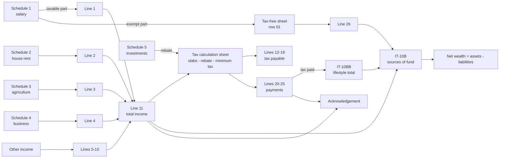

# How the Bangladesh e-Return is calculated

An analysis of the sample return you provided (assessment year 2026-2027), page
by page, with every formula the plugin uses. The sample is an Excel 2010
template printed to PDF: a Government health-complex employee with salary and
house rent, filing a first return. Personal details are left out here; the
figures are the sample's own.

- Income year: 1 July 2025 to 30 June 2026. Assessment (tax) year: 2026-2027.
- Law: Income Tax Act 2023 (ITA 2023). Rates and thresholds come from the yearly
  Finance Act.

---

## 1. The 12 pages

| # | Form | What it holds | Where its figures come from |
|---|---|---|---|
| 1 | IT-11 Chha (2023) acknowledgement receipt | Tax office's receipt: total income and total tax paid | Return lines 11 and 24 |
| 2 | IT-11GA 2023, page 1 | Identity: name, NID, TIN, circle, zone, residency, special-benefit boxes, date of birth, spouse, address, employer | Your information |
| 3 | IT-11GA 2023, page 2 | Income lines 1-11, tax lines 12-19 | Schedules and the tax calculation sheet |
| 4 | IT-11GA 2023, page 3 | Payments 20-25, tax-free income 26, documents list, verification | Tax calculation and tax-free sheets |
| 5 | Schedule 1 | Salary: (a) Government pay scale, (b) everyone else | Your information |
| 6 | Schedules 2 and 3 | House property income; agricultural income | Your information |
| 7 | Schedules 4 and 5 | Business income and balance sheet; investments for the tax rebate | Your information |
| 8 | IT-10BB (2023) | Lifestyle (living) expenses | Your information plus tax paid |
| 9 | IT-10B (2023), page 1 | Sources of fund, net wealth, liabilities | Return, IT-10BB |
| 10 | IT-10B (2023), page 2 | Assets on 30 June | Your information (one item balances the statement) |
| 11 | Tax calculation | Slab tax, rebate, minimum tax, surcharge, tax paid, balance | Return lines |
| 12 | Tax-free income | 22 kinds of exempt income | Schedule 1 exemption plus your information |

## 2. How the pages feed each other



Two figures connect everything: **total income (line 11)** and **total tax paid
(line 24)**. Change any income and both the tax and the wealth statement move.

## 3. The sample, line by line

### Step 1. Salary (Schedule 1, part a: Government pay scale)

| Item | Income | Tax-exempt | Taxable |
|---|---:|---:|---:|
| Basic pay | 462,648 | | 462,648 |
| Festival allowance | 53,160 | | 53,160 |
| Baishakhi allowance | 5,308 | 5,308 | |
| **Total** | **521,116** | **5,308** | **515,808** |

Rule: an employee paid under the Government pay scale is taxed only on basic pay
and festival allowance; every other allowance (house rent, medical, conveyance,
Baishakhi and so on) is exempt. Taxable 515,808 goes to **line 1**; the exempt
5,308 goes to the tax-free sheet (row 01), then to **line 26** and to IT-10B 1(b).

For everyone else, part b applies: total salary (basic, allowances, perquisites,
employer's provident fund contribution...) less the exemption of **one third of
the total or a fixed cap, whichever is lower** (Tk 4,50,000 in the sample's
table; Tk 5,00,000 reported for AY 2026-27).

### Step 2. House property (Schedule 2)

| | Tk |
|---|---:|
| Rent received or annual value, whichever is higher | 395,000 |
| Less repair and collection allowance, 25% | (98,750) |
| **Income from house property (line 2)** | **296,250** |

The allowance is 25% for residential and 30% for commercial property. Municipal
tax, land revenue, loan interest and insurance premium are deducted on top.
With part ownership, only your share goes to line 2.

### Step 3. Total income

Line 11 = 515,808 + 296,250 = **812,058**. Lines 3-10 (agriculture, business,
capital gains, bank interest, other sources, firm share, spouse/minor, foreign)
are zero in the sample.

### Step 4. Tax on the slabs (tax sheet B, line 12)

| Slab | Income | Rate | Tax |
|---|---:|---:|---:|
| First (tax-free) | 400,000 | 0% | - |
| Next | 100,000 | 5% | 5,000 |
| Next | 312,058 | 10% | 31,205.8 |
| **Total** | **812,058** | | **36,206** |

Tk 4,00,000 is the women's tax-free limit in this slab table (general taxpayers
Tk 3,50,000). Tax is rounded to the nearest taka once, at the total.

### Step 5. Tax rebate on investments (tax sheet C, line 13, Schedule 5)

Rebate = the **lowest** of:

1. 3% of taxable income: 812,058 x 3% = 24,362
2. 15% of eligible investment (Schedule 5): 0 x 15% = 0
3. Tk 10,00,000

The sample has no investment, so the rebate is **0**.

### Step 6. Minimum tax and tax payable (D, E, F; lines 14-16)

- Net tax after rebate (line 14) = 36,206 - 0 = 36,206
- Minimum tax (line 15) = Tk 5,000
- Tax payable (line 16) = the higher of the two = **36,206**

### Step 7. Surcharge and total (G, H, I; lines 17-19)

Net wealth is about Tk 1.55 crore, below the Tk 4 crore surcharge limit, so no
surcharge. No delay interest, no savings-certificate final tax.
Total amount payable (line 19) = **36,206**.

### Step 8. Payments (J, K; lines 20-25)

No tax was deducted at source and no advance tax was paid, so the whole 36,206
is paid with the return by A-challan (line 23). Line 24 (total paid) = 36,206,
line 25 (deficit or excess) = 0. The acknowledgement receipt shows total income
812,058 and total tax paid 36,206.

### Step 9. Lifestyle expenses (IT-10BB)

| | Tk |
|---|---:|
| Food, clothing and essentials | 200,000 |
| Housing (family house, so nil) | - |
| Tax paid (line 24) | 36,206 |
| **Total** | **236,206** |

### Step 10. Assets, liabilities and net wealth (IT-10B)

| Sources of fund | Tk |
|---|---:|
| 1(a) Total income (line 11) | 812,058 |
| 1(b) Tax-exempt income (line 26) | 5,308 |
| 1(c) Receipt of gift and others (first return) | 14,882,682 |
| **Total sources** | **15,700,048** |
| 2. Net wealth last year | (none: first return) |
| 4. Less lifestyle expenses (IT-10BB) | (236,206) |
| **5. Net wealth on 30 June 2026** | **15,463,842** |
| 6. Liabilities | - |
| **7. Gross wealth** | **15,463,842** |

| Assets | Tk |
|---|---:|
| Two plots of land (6,700,000 each) | 13,400,000 |
| Provident fund | 950,048 |
| Gold ornaments (25 bhori, wedding gift, shown at nil) | - |
| Furniture and electronics (wedding gift) | 300,000 |
| Cash and bank | 813,794 |
| **Total assets** | **15,463,842** |

The statement must balance: **sources + last year's net wealth - expenses =
assets - liabilities**. One figure is therefore always worked out from the
others. On this first return it is 1(c) "Receipt of gift and others":

```
gift = total assets - liabilities + expenses - income - exempt income - last year's net wealth
     = 15,463,842 - 0 + 236,206 - 812,058 - 5,308 - 0 = 14,882,682
```

That is the opening wealth being declared for the first time: land 13,400,000 +
provident fund 950,048 + furniture 300,000 + opening cash 232,634. The year-end
cash of 813,794 is that opening cash plus this year's saving
(812,058 + 5,308 - 236,206 = 581,160).

From the second return on, line 2 holds last year's net wealth and the
balancing figure is normally cash and bank.

## 4. The rules in general

### 4.1 Tax-free threshold (the 0% slab)

| Taxpayer | Sample template | AY 2026-27 as reported (Finance Act 2026) | Finance Ordinance 2025 |
|---|---:|---:|---:|
| General | 3,50,000 | 4,00,000 | 3,75,000 |
| Women, and anyone aged 65 or more | 4,00,000 | 4,50,000 | 4,25,000 |
| Persons with disability, third gender | 4,75,000 | 5,25,000 | 5,00,000 |
| Gazetted war-wounded freedom fighter, July Joddha | 5,00,000 | 5,50,000 | 5,25,000 |
| Parent or guardian of a person with disability | +50,000 | +50,000 | +50,000 |

The taxpayer claims a category by ticking its box on page 2 (item 7). If more
than one applies, the highest threshold is used.

### 4.2 Slabs after the threshold

| Sample template | AY 2026-27 as reported |
|---|---|
| next 1,00,000 at 5% | next 3,00,000 at 10% |
| next 4,00,000 at 10% | next 4,00,000 at 15% |
| next 5,00,000 at 15% | next 5,00,000 at 20% |
| next 5,00,000 at 20% | next 20,00,000 at 25% |
| rest at 25% | rest at 30% |

Income from savings certificates (sanchayapatra) is taken out before the slabs
("Less: Sanchayapatra"): the tax deducted on it is the final tax, shown on line H
of the tax sheet and included in the total payable.

### 4.3 Rebate

Rebate = lowest of 3% of taxable income, 15% of eligible investment, Tk 10 lakh;
never more than the slab tax. Eligible investments are the ten Schedule 5 rows:
life insurance premium, DPS (up to its limit), Government securities and savings
certificates, listed shares, provident fund contributions, approved pension
fund, benevolent fund and group insurance, zakat fund, and others.

### 4.4 Minimum tax

Applies only when income is above the tax-free threshold. The sample template
uses a flat Tk 5,000. For AY 2026-27 reports give Tk 5,000 anywhere in the
country and Tk 1,000 for a first-time filer. Other minimum taxes under section
163 (TDS treated as minimum tax, turnover tax for business) are entered
separately; the highest applies. Tax payable = higher of net tax and minimum tax.

### 4.5 Surcharge on net wealth

| Net wealth (IT-10B line 5) | Surcharge |
|---|---:|
| up to Tk 4 crore | nil |
| above 4 crore up to 10 crore, or more than one car, or a house over 8,000 sft in a city corporation | 10% |
| above 10 crore up to 20 crore | 20% |
| above 20 crore up to 50 crore | 30% |
| above 50 crore | 35% |

It is a percentage of the tax payable (for AY 2026-27, reportedly of the
regular tax, not the minimum tax). An environmental surcharge on cars is entered
separately.

### 4.6 Payments and the balance

```
Total payable (line 19) = tax payable + surcharge + delay interest + final tax on savings certificates
Paid (line 24)          = tax deducted at source + advance tax + refund adjusted + paid with return
Deficit or excess (25)  = line 19 - line 24       (excess shown in brackets = refundable)
```

If you don't say how much you will pay with the return, the plugin assumes the
balance due is paid by A-challan, as the sample does.

### 4.7 Display conventions copied from the template

- Zero prints as a dash, except in cells the template leaves blank.
- Negative amounts print in brackets.
- Thousands use commas (15,463,842).
- Dates appear as 6/30/2026, 30-Jun-26 and 20/10/2026, as in the sample.

## 5. What the analysis found in the sample

1. **The slab table is last year's.** The sample taxes the 5% band and uses a
   Tk 4,00,000 women's threshold. Reports on AY 2026-27 say the 5% band was
   removed and thresholds were raised. For the same person:

   | Rules | Tax-free limit | Tax |
   |---|---:|---:|
   | Sample template | 4,00,000 | **36,206** |
   | AY 2026-27 as reported, woman | 4,50,000 | **39,309** |
   | AY 2026-27 as reported, if the Female box is not claimed | 4,00,000 | 46,809 |
   | Finance Ordinance 2025, woman | 4,25,000 | 43,059 |

   If the reported AY 2026-27 rules are right, the sample under-states the tax by
   Tk 3,103. Confirm the figures with the official Finance Act or the NBR
   before filing; the plugin can use either table.
2. **The "Female" box on page 2 is not ticked**, although the women's threshold
   was used. The threshold has to be claimed on the form.
3. **Minimum tax**: the template always shows Tk 5,000. The plugin charges it
   only above the threshold and uses the first-return amount where a profile has one.
4. **Arrear pay** sits in the exempt column of Schedule 1, although its label
   says "if not included in taxable income earlier". The AY 2026-27 profile
   treats it as taxable.
5. **"I. Total Payable (F + G)"** leaves out H (final tax on savings
   certificates). The plugin adds H so the total is right when there is such income.
6. **IT-10BB row 8** shows this year's tax, although its label mentions last
   year's return. The plugin follows the template (it can be overridden).
7. Template wording kept as printed: "(2+3)" on IT-10B line 3 (should read 1+2),
   "Organizaion", "Asssessment", "Registtration", "invetment".

## 6. What changes when you give different information

| You provide | What happens |
|---|---|
| Female, 65+, disability, third gender, freedom fighter | Higher tax-free threshold; the box on page 2 is ticked |
| Private-sector salary | Schedule 1(b); exemption = lower of 1/3 or the cap; exempt part to row 01 of the tax-free sheet |
| Several houses, commercial property, part ownership | Added on one Schedule 2; 30% allowance for commercial; only your share on line 2 |
| Bank interest with tax deducted | Line 6; the deducted tax goes to line 20 |
| Savings-certificate interest | Line 6; removed from slab income; its TDS is the final tax (H) and also a payment |
| Investments (DPS, insurance, provident fund, shares) | Schedule 5; rebate = lowest of 3% of income, 15% of investment, Tk 10 lakh |
| Income below the threshold | No tax and no minimum tax |
| Tax after rebate below the minimum | Minimum tax is payable instead |
| More tax deducted than payable | Line 25 shows the excess in brackets (refundable) |
| Net wealth over Tk 4 crore, or more than one car | Net wealth surcharge on line 17 |
| Not a first return | Last year's net wealth on IT-10B line 2; cash becomes the balancing figure |
| Assets that cannot be explained | A warning: the balancing figure would be negative, so a figure is wrong or a source (gift, loan) is missing |

Worked example (`skills/e-return/examples/private-employee.json`, AY 2026-27 rules):

| | Tk |
|---|---:|
| Private salary 12,84,000 - exempt 1/3 (4,28,000) | 856,000 |
| Rent 2,40,000 - 25% - municipal tax 6,000 - land revenue 1,500 | 172,500 |
| Bank interest 25,000 + savings-certificate interest 55,200 | 80,200 |
| **Total income** | **1,108,700** |
| Slab income (savings certificate interest taken out) | 1,053,500 |
| Slab tax: 4,00,000 at 0, 3,00,000 at 10%, 3,53,500 at 15% | 83,025 |
| Rebate: lowest of 3% (31,605), 15% of 2,94,000 (44,100), 10 lakh | (31,605) |
| Tax payable | 51,420 |
| Final tax on savings certificates | 5,520 |
| **Total payable** | **56,940** |
| Paid: salary TDS 48,000 + certificate AIT 5,520 + bank AIT 2,500 | 56,020 |
| **Paid with the return** | **920** |

## 7. Sources

The rule tables come from news and professional summaries. The official
gazette could not be opened from the build environment, so treat the AY 2026-27
figures as reported, not verified.

- [The Daily Star: Finance bill passed, tax-free income threshold set at Tk 4 lakh for FY2026-27](https://www.thedailystar.net/business/bangladesh-budget-2025-26/news/finance-bill-passed-tax-free-income-threshold-set-tk-4-lakh-fy2026-27-4211511)
- [The Business Standard: Finance Bill passed with tax-free income threshold set at Tk4 lakh](https://www.tbsnews.net/economy/finance-bill-passed-parliament-tax-free-income-threshold-set-tk4-lakh-1475511)
- [Dhaka Tribune: Finance Bill 2026 passed with structural revisions](https://www.dhakatribune.com/business/413915/finance-bill-2026-passed-with-structural-revisions)
- [bdnews24: New income tax slabs in effect from July, says NBR chief](https://bdnews24.com/economy/5e8932a40473)
- [Prothom Alo: Tax-free income ceiling to remain unchanged at Tk 350,000](https://en.prothomalo.com/business/local/4nttx2jgti)
- [Prothom Alo: Tax-free income threshold raised to Tk 375,000](https://en.prothomalo.com/business/local/0sug1clq5v)
- [The Financial Express: Minimum income tax Tk 5,000, Tk 1,000 for first-time taxpayers](https://thefinancialexpress.com.bd/home/minimum-income-tax-tk-5000-tk-1000-for-first-time-taxpayers)
- [The Daily Star: How Bangladesh's surcharge and wealth tax system works](https://www.thedailystar.net/business/news/how-bangladeshs-surcharge-and-wealth-tax-system-works-4013321)
- [New Age: Income tax exemption for govt employees widened](https://www.newagebd.net/article/207371/income-tax-exemption-for-govt-employees-widened)
- [ACNABIN: Summary of important changes introduced by the Finance Ordinance 2025](https://bti-global.files.svdcdn.com/production/network/bangladesh/documents/Reports/Summary-of-Important-Changes-Introduced-by-the-Finance-Ordinance-2025-of-BD-ACNABIN.pdf?dm=1749037656)
- [Roy Law Nexus: Bangladesh Income Tax Guide 2026-27](https://roylawnexus.com/legal-insights/bangladesh-income-tax-2026-finance-act-amendments)
